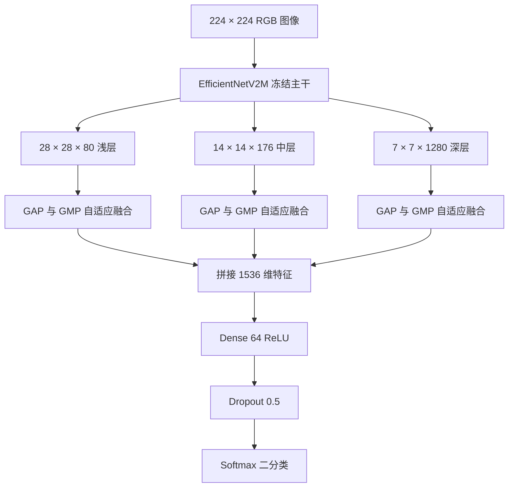
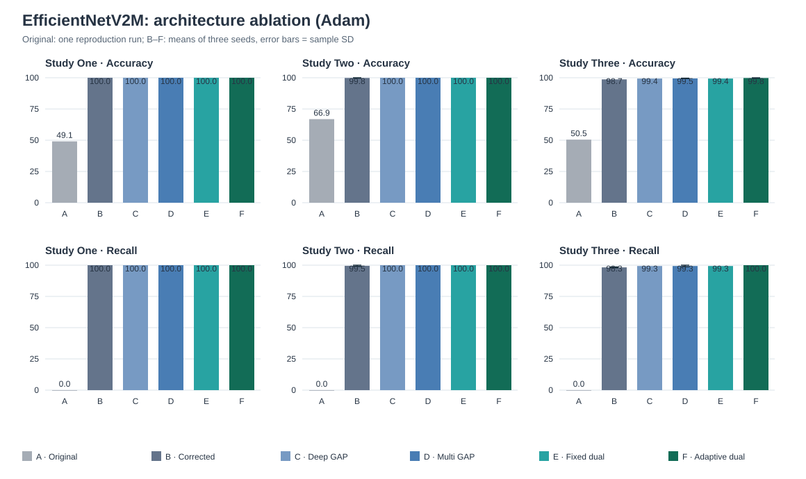
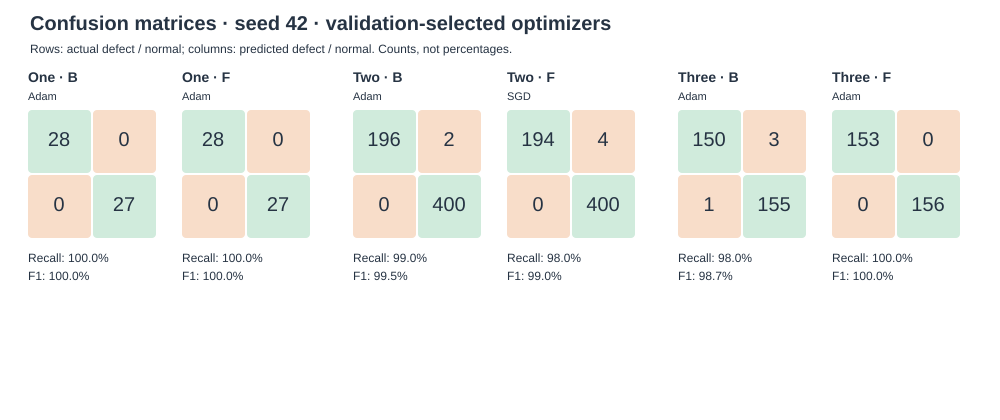
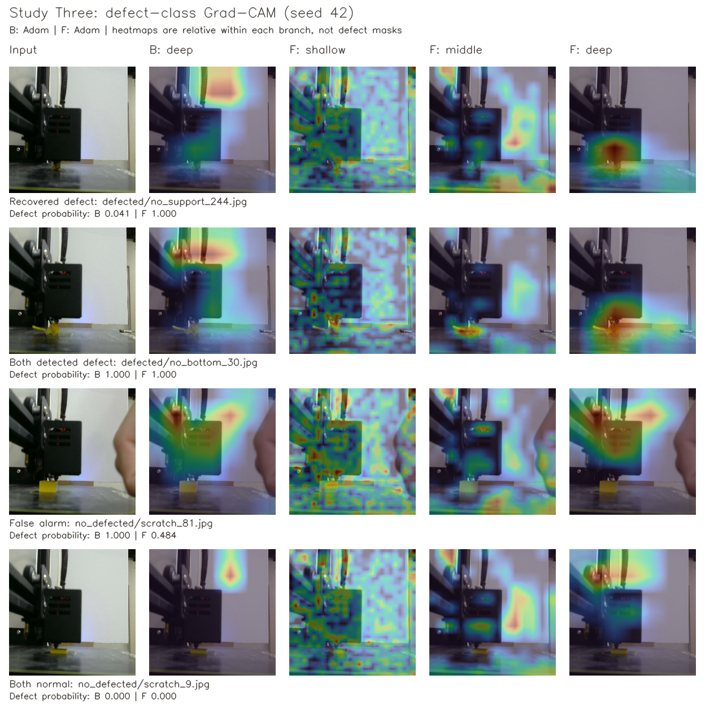

# IDAT7215 3D 打印件缺陷检测迁移学习与模型创新

本项目对应 Topic 4: Python-Based Transfer Learning for 3D Printed Object Defect Detection。基于 Ahsan 等人 2024 年发表于 *Expert Systems with Applications* 的工作，我们复现了 EfficientNetV2M 与 InceptionResNetV2，进一步发现 EfficientNetV2M 的输入尺度问题，并提出面向打印缺陷的自适应多尺度融合模型 **MSAF-EfficientNetV2M**。

项目的主要贡献是模型结构创新，不把纠正输入缩放或普通数据增强带来的提升计入架构创新。**所有结果均来自实际运行和逐图预测**，论文原文数字只放在参考列。提交包包含模型代码、逐图预测、训练日志、分类头权重、消融实验及报告图；原始图片及较大的 ImageNet 权重由准备脚本获取，避免 GitHub 大文件限制。

## 1 主要实验结果

下表将原论文的 EfficientNetV2M 测试准确率、我们的原始复现（A）、修正预处理后的原结构（B）以及完整创新模型（F）放在一起比较。这既能看到相较原论文的整体变化，也能单独判断结构创新的贡献。

| Study | Optimizer | 原论文报告值 | 原始复现 A | 修正预处理 B | 创新模型 F | 结构创新提升 B → F（百分点） |
|---|---|---:|---:|---:|---:|---:|
| One | Adam | 49% | 49.09% | 100.00% | **100.00%** | +0.00 |
| One | SGD | 49% | 49.09% | 98.79% | **100.00%** | +1.21 |
| One | RMSprop | 49% | 49.09% | 100.00% | **100.00%** | +0.00 |
| Two | Adam | 67% | 66.89% | 99.83% | **100.00%** | +0.17 |
| Two | SGD | 67% | 66.89% | 96.43% | **99.33%** | +2.90 |
| Two | RMSprop | 67% | 66.89% | 99.78% | **100.00%** | +0.22 |
| Three | Adam | 50% | 50.49% | 98.71% | **99.78%** | +1.08 |
| Three | SGD | 50% | 50.49% | 84.14% | **94.17%** | +10.03 |
| Three | RMSprop | 50% | 50.49% | 97.52% | **99.35%** | +1.83 |

说明：原论文报告值来自论文表 2–10 中的 Test Accuracy，按论文舍入精度呈现；A 是本组 seed 42 的独立复现。B 和 F 在相同数据划分及优化器下分别训练三个种子（42、43、44），表中为平均准确率。B → F 的差值按未四舍五入的均值计算。原论文未公开逐图划分，因此原论文与本次实验的具体测试图片可能不同。

例如 Study Three 使用 SGD 时，原论文报告 50%，本组复现为 50.49%，修正预处理后提高到 84.14%，最终模型为 94.17%。从修正后的公平基线 B 到 F 的 **10.03 个百分点** 才归于本次模型结构创新；不能将从原论文到 F 的全部提升归于新结构。

Study Three 上，Adam 的缺陷召回率由 98.26% 提升至 100.00%，三个训练种子都检出了全部 153 张缺陷图；SGD 的准确率提升 10.03 个百分点。准确率不能代替缺陷召回率，因此报告同时给出 Recall、F1、混淆矩阵和逐图结果。

**按论文表 2–10 的结果格式：** [九张完整结果表](paper_results/paper_style_tables.md)，分别针对三个 Study 和 Adam、SGD、RMSprop 展示 Train、Validation、Test 的 Accuracy、Precision、Recall、F1-score、MCC、Kappa、AUC、mAP，并列出正确数/总数及论文原始 Accuracy。详细的所有随机种子数据见 [459 行实测指标](paper_results/all_metrics.csv)。如需对比模型稳定性，应使用 [三种子汇总](paper_results/three_seed_test_summary.csv)，而不只展示一次最高准确率。

## 2 数据集及实验设置

数据来源为[作者 GitHub 数据集](https://github.com/mahsan2/AMdataset)以及作者论文所使用的 [Kaggle Study Three 数据](https://www.kaggle.com/datasets/justin900429/3d-printer-defected-dataset)。

| 数据集 | 缺陷 / 正常 | Train / Validation / Test | Batch size | Epochs |
|---|---:|---:|---:|---:|
| Study One 原始圆柱照片 | 136 / 135 | 189 / 27 / 55 | 8 | 30 |
| Study Two 作者增强照片 | 947 / 2070 | 2111 / 308 / 598 | 50 | 50 |
| Study Three Kaggle 照片 | 759 / 798 | 1089 / 159 / 309 | 30 | 30 |

全部 4845 张图片使用 OpenCV 解码、转 RGB、缩放到 224×224。按相对文件路径排序，沿用原作者两次非分层随机划分，第一次 `test_size=0.30`，第二次 `test_size=0.66`，两次 `random_state=42`。**每组内的所有模型共享同一逐图划分**。类别 0 是缺陷，1 是正常。本次公开 Study One 原图比论文少一张正常图；作者未公开逐图划分清单，具体测试图片可能有差异。

迁移学习使用 ImageNet 预训练权重，冻结主干（包括 BatchNorm），统一损失为二元交叉熵，学习率 0.001，分别使用 Adam、SGD、RMSprop，训练最终轮权重用于评价。原复现采用固定种子 42；创新消融实验使用 42、43、44 三个种子，并保持相同训练样本、轮数和梯度更新次数。主实验没有新增数据增强。

`assets_manifest.csv` 保存所有图片的相对路径与 SHA-256。`prepare_assets.py` 优先下载作者固定 Git 提交 `52fe75dec70c1e8046493b4e3256f8f752a4d39d` 的归档，缺少的文件逐个补下载并校验；Kaggle 使用版本 1。预训练权重取自 Keras 官方地址，校验 MD5。

## 3 原论文复现及问题定位

### 修改内容对照

组员可以先看下面的表，理解我们从原作者提供的模型出发，具体修改了哪一步，以及对应代码在哪里。

| 修改位置 | 原方法 | 我们的做法 | 为什么这样做 | 对应代码 |
|---|---|---|---|---|
| 图片输入 | RGB 像素先除以 255，再进入模型内置缩放 | 直接输入 0–255 的 RGB 浮点值 | 防止重复缩放，使 ImageNet 主干接收正常范围的输入 | [`innovation/run.py` 的 `pixel_batch()`](innovation/run.py) |
| 特征提取 | 只取最后一层 7×7 特征图 | 同时提取 28×28、14×14、7×7 三个尺度 | 浅层分辨率较高，保留细节；深层提供整体结构信息 | [`make_encoder()`](innovation/run.py) |
| 池化 | 4×4 固定平均池化 | 对每个尺度同时计算全局平均与全局最大池化 | 既汇总整张特征图，又减少小范围强响应被平均稀释的可能 | [`pooled()`](innovation/run.py) |
| 池化特征融合 | 没有局部/整体的可学习融合机制 | 每个尺度增加一个 sigmoid 门，学习 GAP/GMP 的比例，再拼接 | 让模型根据输入自动选择更有用的局部峰值与整体信息 | [`make_head()` 的 F 分支](innovation/run.py) |
| 结构对照 | 使用固定模型分类头 | 保留 Dense(64)、Dropout(0.5)、二分类输出；设计 B–F 五个对照 | 控制训练条件，单独验证多尺度和门控是否有效 | [`fit_all()`、`evaluate_all()`](innovation/run.py) |

第一行是预处理纠正，第二至四行是本组的结构创新。最后一行属于实验设计。后续重点比较经纠正的 B 和完整创新 F，从而区分两类贡献。

原作者的 [basic_algorithm.ipynb](https://github.com/mahsan2/AM3d/blob/main/basic_algorithm.ipynb) 将全部图像除以 255，再输入不同的预训练模型。EfficientNetV2M 的 Keras 实现默认包含内置预处理层（`include_preprocessing=True`），应接收 `[0,255]` 浮点像素。该版本内置操作为 x/128−1；额外除以 255 会把实际卷积输入压缩到约 `[-1,-0.9922]`，而正确范围约 `[-1,0.9922]`。详见 [Keras 官方说明](https://keras.io/api/applications/efficientnet_v2/efficientnet_v2_models/#efficientnetv2m-function)。

### 复现原作者设置（A）

为了复现，先保留这套输入处理及分类头：冻结主干 → 4×4 平均池化 → Flatten → Dense(64, ReLU) → Dropout(0.5) → Dense(2, Softmax)。原始 EfficientNetV2M 三组所有优化器均输出同一测试准确率：Study One 49.09%、Study Two 66.89%、Study Three 50.49%，缺陷召回率均为 0%，实测准确率取整后与原论文一致。这说明模型只预测正常类。

### 独立修正输入（B）

保留主干默认缩放，直接输入 `[0,255]`，不额外除以 255，模型结构保持原样。早期控制实验以 Adam、固定种子 42、相同训练数据顺序、无新增强为条件，仅改变输入尺度：

| 数据集 | 原输入 | 正确输入 | 正确输入下缺陷 Recall |
|---|---:|---:|---:|
| One | 49.09% | 100.00% | 100.00% |
| Two | 66.89% | 100.00% | 100.00% |
| Three | 50.49% | 99.03% | 98.69% |

这证明在我们的复现环境中，输入尺度是导致原模型异常的重要原因；尚不能据此确定原论文作者的所有运行环境及实现完全一致。故后续结构创新必须与正确输入的 B 对比，而不是仅与有缩放问题的 A 对比。

此外，早期数据增强实验独立比较无增强、几何增强（轻微旋转和平移）以及几何与光照增强，在 2 种输入尺度 × 3 种增强 × 3 Study × 3 优化器条件共训练 54 组。修正尺度后的验证结果中，几何增强平均准确率 97.23%，无新增强 97.20%，差异很小。因此本项目选择模型结构创新为主，增强实验作为补充，不与模型改进叠加。详见 [增强实验说明](augmentation_study/实验说明.md) 和 [增强实验结果](augmentation_study/test.csv)。

## 4 核心创新 MSAF-EfficientNetV2M

### 4.1 为什么修改结构

原模型仅使用最后一层输出；EfficientNetV2M 输入尺寸 224×224 时，最后一层特征图为 7×7×1280。原 4×4、步长 4、VALID 的平均池化只覆盖 4×4 的一个区域，丢弃其余空间位置的特征。细小缺陷也可能在深层特征提取过程中被弱化。我们的目标是同时利用不同深度的纹理、边缘和语义信息，并更灵活地保留局部峰值响应。

### 4.2 多尺度特征提取

从冻结主干提取三组不同分辨率的特征图：

| 网络层名称 | 尺寸 | 设计动机 |
|---|---|---|
| `block3e_add` | 28×28×80 | 细小纹理及局部边缘 |
| `block5n_add` | 14×14×176 | 中尺度局部结构 |
| `top_activation` | 7×7×1280 | 整体形状和深层语义 |

三个尺度的输出在一次前向传播中获取。由于主干被冻结，可缓存各尺度池化后的特征以加速后续训练，避免重复计算，但不会改变模型输出。

### 4.3 自适应双池化与融合

对每个尺度 i，计算全局平均池化向量 A_i（GAP）和全局最大池化向量 M_i（GMP），分别做无训练参数的 LayerNormalization（epsilon=1e−5，center=False，scale=False）。平均池化概括整体响应，最大池化保留各通道的强局部响应。通过可学习 sigmoid 门控计算每张图的最大池化权重：

用一个简单的例子理解池化：假设一个 4×4 特征区域有 15 个位置的响应为 0，而一个细小缺陷的位置响应为 8，那么平均池化只得到 0.5，最大池化仍能得到 8。只用平均值容易削弱这样的强局部响应，只用最大值又可能被背景噪声影响。我们让网络学习在这两种信息之间如何取舍。这个例子仅用于说明设计动机，并非实测特征值。

```text
g_i = sigmoid(w_i · concat(A_i, M_i) + b_i)
f_i = (1 - g_i) · A_i + g_i · M_i
f   = concat(f_1, f_2, f_3)
```

每个尺度只有一个标量门控，零初始化使训练前 g_i=0.5；固定双池化 E 与自适应双池化 F 在同种子下具有相同初始预测，训练后 F 能自行调整两种响应的比例。三个融合向量拼接为 1536 维，再接 Dense(64, ReLU)、Dropout(0.5)、Dense(2, Softmax)。



与修正后的 B 相比，F 总参数只增加 19,459 个（约占完整模型的 0.037%），其中自适应门控增加 3,075 个参数。各模块有既有研究基础，我们的创新贡献是针对本任务设计、组合并验证该结构，不宣称基础池化机制为全球首次提出。

## 5 消融实验设计与结果分析

采用五个新增对照 B–F：

| 方案 | 设置 | 验证目的 |
|---|---|---|
| A | 原作者设置，原缩放 | 历史复现基线 |
| B | 只修正输入，保留原结构 | 公平比较基线 |
| C | 深层 GAP + 固定归一化 | 完整深层信息 |
| D | 三尺度 GAP 特征融合 | 多尺度信息的贡献 |
| E | 三尺度 GAP/GMP 固定等权融合 | 最大池化的影响 |
| F | 三尺度自适应双池化 | 门控学习的额外贡献 |

135 次新训练 = 5 方案 × 3 Study × 3 优化器 × 3 种子。相同 Study/种子下训练批次顺序一致，D/E/F 分类头维度与初始化相同。原 A 历史单种子结果单独列示。Study Three 的 Adam 消融结果如下：

| 模型 | Accuracy (%) | Defect Recall (%) | F1-score (%) |
|---|---:|---:|---:|
| A 原复现（单种子） | 50.49 | 0.00 | 0.00 |
| B | 98.71 | 98.26 | 98.69 |
| C | 99.35 | 99.35 | 99.35 |
| D | 99.46 | 99.35 | 99.45 |
| E | 99.35 | 99.35 | 99.35 |
| **F** | **99.78** | **100.00** | **99.78** |

从 B 到 C 同时改变池化方式与固定归一化，不能将收益仅归因于池化；C 到 D 验证多尺度，E 到 F 验证自适应权重的增量贡献。F 相比 E 提高 0.43 个百分点，说明 Study Three 上学习融合权重具有额外收益。不代表所有优化器、所有数据域都提高，也不能在只有同一测试集的三个训练种子下证明统计显著性。





验证集以三种子平均 F1 最高者选择优化器，平局优先缺陷 Recall，再取固定顺序 Adam、SGD、RMSprop。Study Three B/F 都选择 Adam；Study Two B 选择 Adam 而 F 选择 SGD，其验证选择方案测试准确率由 99.83% 降到 99.33%，因此应报告真实的负结果；同优化器对照见第 1 节，不按测试结果倒选优化器。

### 5.1 可解释性

以 Grad-CAM 显示模型对缺陷得分的响应，F 分别显示三个特征分支的梯度响应。Study Three 的 `no_support_244.jpg`，基线模型缺陷预测概率为 0.041，F 为 0.9997；F 的深层响应更接近喷嘴与打印区域。这是定性例证，数据无像素级缺陷标注，所以不能将热力图当作缺陷定位精度。



### 5.2 泛化与局限

| 训练 → 测试 | B Accuracy / Recall / F1 (%) | F Accuracy / Recall / F1 (%) |
|---|---:|---:|
| One → Three | 54.25 / 82.35 / 63.35 | 56.86 / 18.53 / 29.14 |
| Three → One | 66.05 / 83.82 / 71.41 | 83.03 / 82.35 / 82.99 |

两方向跨数据集结果不一致；存在域偏移，尤其 One 训练的 F 测试 Three 时缺陷召回率大幅降低。三组数据图像级划分，虽未发现跨集合完全相同文件（SHA-256），也无法排除同一工件的不同拍摄帧或同一原图的增强版本。Study Two 是作者发布的增强图，不能据此声称对全新打印件有同样高性能。原测试集也已在复现中用过，不是全新盲测集。未来应按工件或视频序列分组，建立真正独立的外部测试。

## 6 结果表的口径（与原论文格式对应）

论文第 4.6 节、式 (11) 用正态近似 95% 置信区间；本项目每个单次运行采用实际正确张数/样本数计算准确率 p，并按式 (11) 计算半宽 1.96 × sqrt(p × (1−p) / n)。因此原格式 `0.99 ± 0.01` 表示准确率比例及置信区间半宽，另提供准确率百分比和正确数/总数。我们复算自己的区间，**不强行照抄原论文的置信区间数字**；原论文 Accuracy 的印刷值另列。100% 的正态区间半宽为零并不代表完全没有不确定性。

完整结果表：[论文格式九表](paper_results/paper_style_tables.md)。Train、Validation、Test 都使用最终分类头、推理模式的预测（关闭 Dropout），而不是训练时最后一轮的 batch accuracy。所有 Precision、Recall、F1、MCC、Kappa、AUC、mAP 作为点估计：缺陷为正类，mAP 为两个类别 AP 的平均。论文部分行的其他指标可能采用不同类别平均口径，因此不能直接混用；Accuracy 可直接按相同定义对照。重复训练的 `mean ± SD` 是三个训练种子的样本标准差（百分比），**不等同于 95% 置信区间**。

## 7 如何运行项目

### 7.1 直接查看已有结果（不需要安装 TensorFlow）

GitHub 可以直接点击查看 [论文格式结果表](paper_results/paper_style_tables.md) 和 [完整 CSV](paper_results/all_metrics.csv)。下载代码或 clone 后，进入本目录，使用 Python 3.12 执行：

```bash
python main.py
```

该命令核验原始复现、数据增强和全部 459 份 Train/Validation/Test 预测文件，重新计算准确率和其他指标，并在终端输出 A/B/F 每个 Study × 优化器的 `Accuracy = p ± 95% CI`、百分比及正确数/总数。无需数据集或主干权重，无需网络。

### 7.2 配置环境和数据

使用 Python 3.12；本次环境为 Python 3.12.14、TensorFlow 2.18.0、Keras 3.8.0，Apple M5 CPU。

```bash
python -m venv .venv
```

macOS/Linux：`source .venv/bin/activate`；Windows PowerShell：`.venv\Scripts\Activate.ps1`。

```bash
python -m pip install -r requirements.txt
python main.py prepare
python main.py check-assets
```

传输体积较大（原始图片约 919 MB、两模型权重约 413 MB）；首次下载需联网。也可直接将原项目中已有的 `data/` 和 `.keras/models/` 复制到本目录，再执行校验。下载文件不提交 Git。完整实测环境版本另见 `requirements-lock.txt`。在其他硬件和软件环境重新训练，浮点数细节可能不同；随包历史逐图预测是本文所报告的实际结果依据。

### 7.3 重新训练和补算结果

推荐复制一份项目目录再从零重跑，防止覆盖随包发布的已验收结果。

```bash
# 原论文 EfficientNetV2M 九组复现
python train.py --model EfficientNetV2M
python verify.py --model EfficientNetV2M

# 原论文 InceptionResNetV2 九组复现（作为参考）
python train.py --model InceptionResNetV2
python verify.py --model InceptionResNetV2

# 输入预处理及数据增强对照（54 组）
python augmentation_experiment.py
python summarize_augmentation.py

# 核心 MSAF 结构创新（B-F，共 135 组）
python innovation/run.py
python innovation/report.py
python innovation/explain.py

# 补算全部 Train 最终权重预测，再生成与论文对应的结果表
python export_train_predictions.py
python main.py
```

`innovation/run.py` 支持 `--stage cache/train/evaluate`，缓存丢失会自动重建。已存在且配置/数据一致的运行自动跳过；若要从零训练 B–F，请在重跑副本中先移走 `innovation/results/one/{B,C,D,E,F}`、`two/{B,C,D,E,F}`、`three/{B,C,D,E,F}` 的训练结果目录，再执行全部阶段。单模型原复现可用 `--study three --optimizer Adam` 指定组合。CPU 完整特征提取耗时取决于机器。

## 8 项目文件与结果索引

| 路径 | 用途 |
|---|---|
| `main.py` | 一键重新核验保存的预测并打印 Accuracy |
| `prepare_assets.py` / `assets_manifest.csv` | 获取和校验原始数据与权重 |
| `train.py` / `verify.py` | 原论文两模型训练与结果核验 |
| `augmentation_experiment.py` | 输入尺度和数据增强独立实验 |
| `innovation/run.py` | B–F 模型结构、训练、验证选择、测试及跨域评价 |
| `innovation/report.py` / `explain.py` | 统计、消融图、热力图、模型参数和推理时间 |
| `export_train_predictions.py` | 从最终权重补生成训练集预测 |
| `paper_tables.py` / `paper_results/` | 论文格式结果表及三种子汇总 |
| `results/` / `results_efficientnetv2m/` | 两原模型逐图预测、日志、权重 |
| `augmentation_study/` | 54 组增强对照结果 |
| `innovation/results/` | 135 组创新结果、图表和分类头权重 |

## 9 参考资料

1. M. M. Ahsan et al. (2024), *Defect analysis of 3D printed object using transfer learning approaches*, Expert Systems With Applications 253, 124293. [论文 DOI](https://doi.org/10.1016/j.eswa.2024.124293)
2. [作者项目 AM3d](https://github.com/mahsan2/AM3d)；[作者数据 AMdataset（固定提交）](https://github.com/mahsan2/AMdataset/tree/52fe75dec70c1e8046493b4e3256f8f752a4d39d)；[Study Three 数据集](https://www.kaggle.com/datasets/justin900429/3d-printer-defected-dataset)。
3. [Keras EfficientNetV2 官方输入处理约定](https://keras.io/api/applications/efficientnet_v2/efficientnet_v2_models/)。
4. Yang et al. (2020), [A Deep Learning-Based Surface Defect Inspection System Using Multiscale and Channel-Compressed Features](https://ris.utwente.nl/ws/portalfiles/portal/232238288/Yang_2020_A_deep_learning_based_surface_defec.pdf)。
5. Selvaraju et al. (2017), [Grad-CAM: Visual Explanations From Deep Networks via Gradient-Based Localization](https://openaccess.thecvf.com/content_iccv_2017/html/Selvaraju_Grad-CAM_Visual_Explanations_ICCV_2017_paper.html)。
